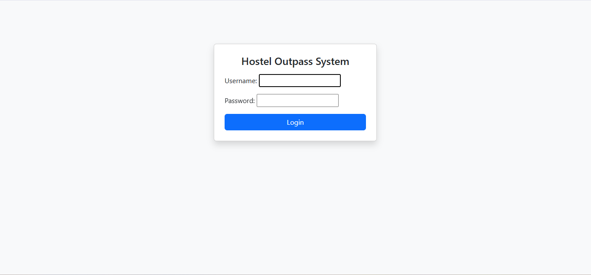
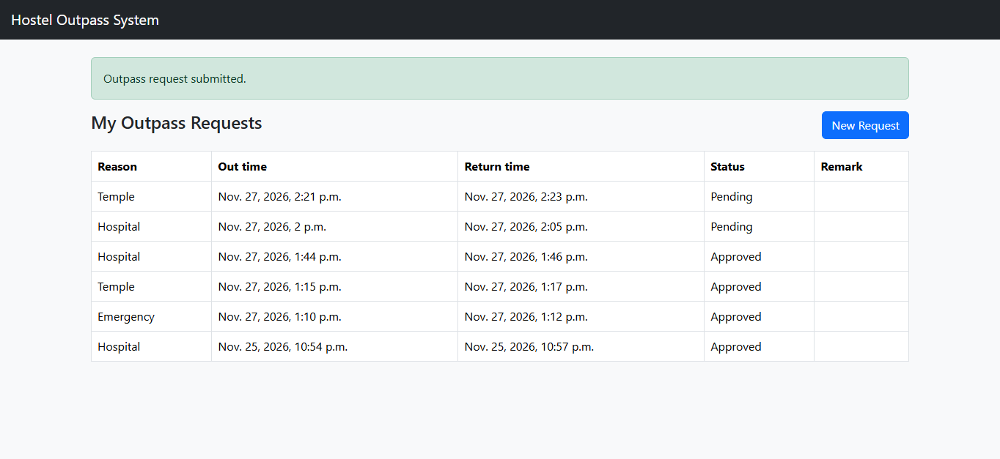
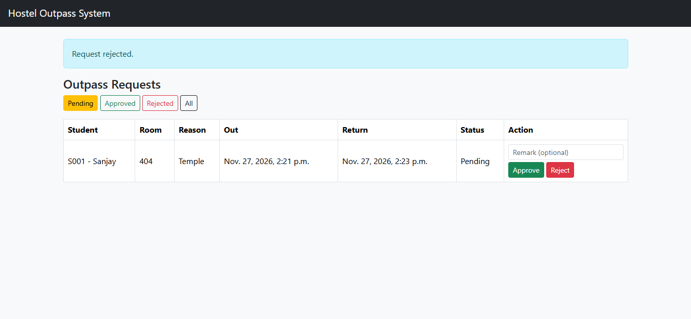
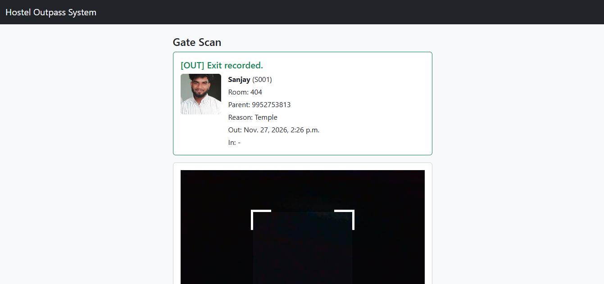
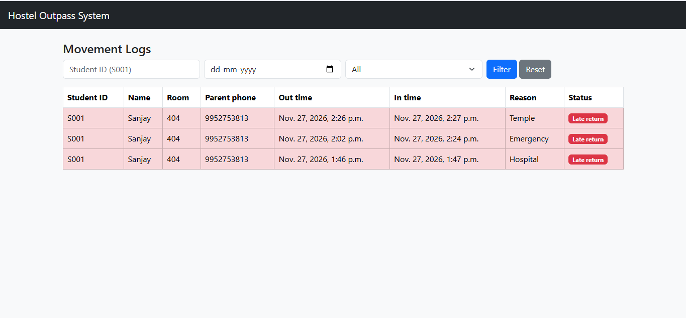

# Hostel Outpass Management System

A Django web app that digitizes hostel outpasses: students request, wardens approve, and security records every exit and entry with a QR-based gate scan.

## Features
- Role-based login: Student, Warden, Security
- Student outpass request (reason, out time, return time) with request history
- Warden dashboard to approve or reject requests with remarks, filter by status
- Unique student ID with QR code
- Gate scan page (camera or manual ID): shows student details, validates an approved outpass, auto-detects exit or entry
- Movement log: who left, when they left, when they returned, and why
- Parent notification- Automatic parent email notification on every exit and entry (Django mail, Gmail SMTP)

## Tech Stack
Python, Django, SQLite, HTML, CSS, JavaScript, Bootstrap, html5-qrcode, qrcode (Python)

## How It Works
1. Student submits an outpass request.
2. Warden approves it.
3. At the gate, security scans the student QR. The system records the out time and notifies the parent.
4. On return, the next scan records the in time.

## Setup
```
git clone https://github.com/sanjaykumar-k1/hostel-outpass-system.git
cd hostel-outpass-system
python -m venv venv
venv\Scripts\activate
pip install -r requirements.txt
python manage.py migrate
python manage.py createsuperuser
python manage.py runserver
```
Open http://127.0.0.1:8000/ and log in. Create users, the `Warden` and `Security` groups, and Student profiles from `/admin/`.

## Screenshots







## Author
Sanjaykumar K | skillsanjay0101@gmail.com